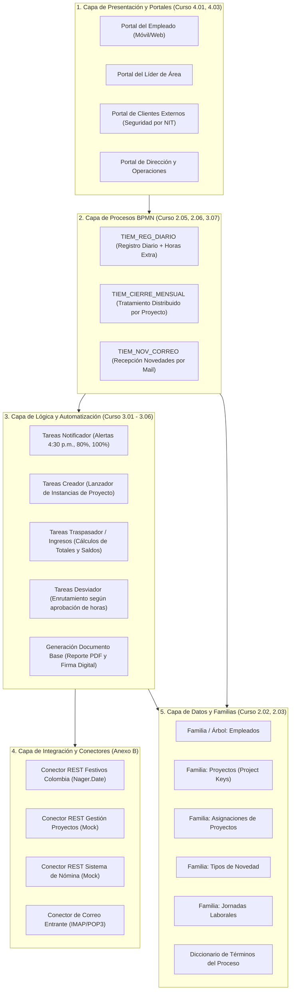
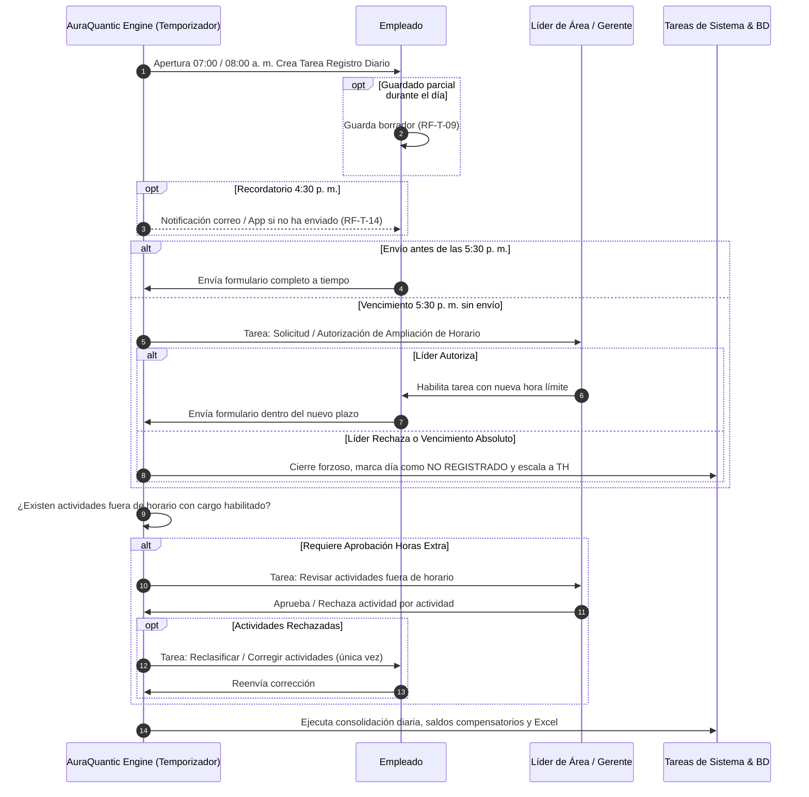
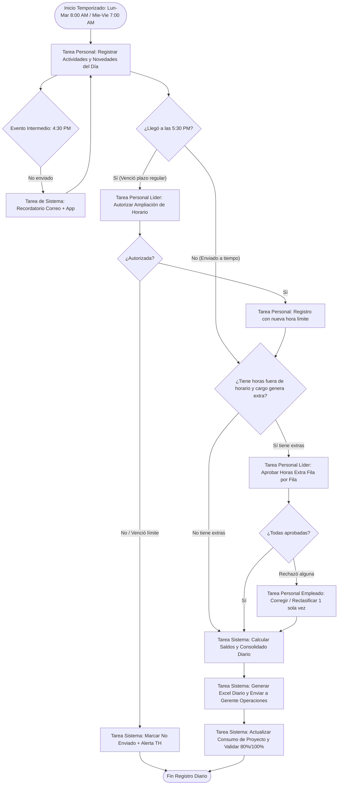
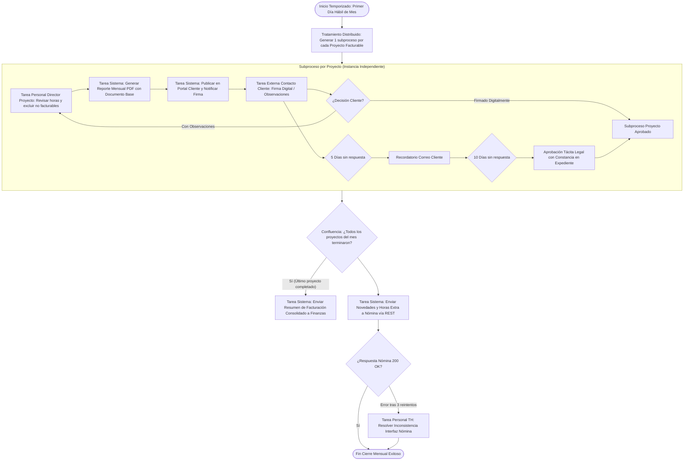
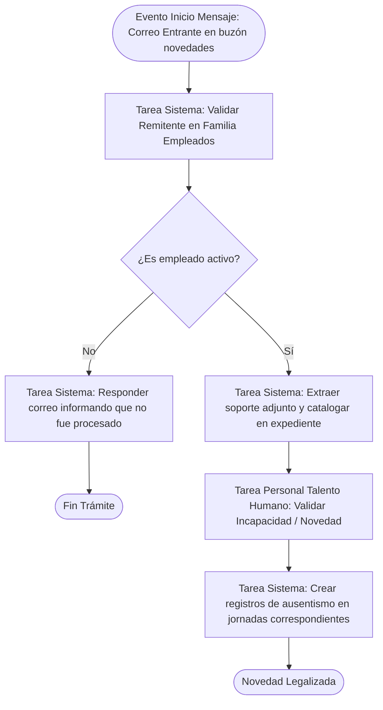

# Fases 1 y 2: Documento de Análisis del Proceso y Propuesta Técnica AuraQuantic

**Caso 1:** Registro de Tiempos, Novedades y Facturación de Horas  
**Programa:** Bootcamp AuraQuantic  
**Versión:** 2.0  
**Fecha:** 2026-11-18  
**Autor:** Consultoría de Arquitectura y Automatización AuraQuantic  

---

## 1. FASE 1: DOCUMENTO DE ANÁLISIS DEL PROCESO (ENTENDIMIENTO)

### 1.1 Contexto y Objetivos del Negocio
Una firma de servicios profesionales y consultoría factura a sus clientes bajo la modalidad de horas laboradas. Actualmente, la captura de tiempos y novedades se realiza mediante herramientas dispersas y hojas de cálculo manuales, lo que ocasiona:
1. Carencia de visibilidad operativa sobre la asignación real de tiempo por empleado y proyecto.
2. Inconsistencias en el cálculo de horas extra, ausentismos y saldos de compensación para nómina.
3. Riesgo de sobrecostos por desbordamiento de presupuestos de horas contratadas.
4. Fricción y demoras en la emisión, revisión y aprobación de reportes mensuales de facturación a clientes.

**Objetivo de la Solución:**  
Implementar en AuraQuantic un ecosistema de procesos automatizados de punta a punta que:
* Asegure el registro diario estandarizado de actividades y novedades por empleado según su jornada y calendario laboral.
* Automatice la aprobación de horas extra por parte de los líderes de área y aplique las validaciones laborales correspondientes.
* Controle en tiempo real el consumo de presupuesto por proyecto (alertas al 80 % y 100 %).
* Ejecute el cierre mensual mediante tratamientos distribuidos por proyecto, generando el reporte PDF con firma digital del cliente y aprobación tácita a los 10 días hábiles.
* Consolide y transmita las novedades a nómina (REST) y el resumen mensual a Finanzas.

---

### 1.2 Mapa de Actores y Matriz RACI

| Rol / Actor | Tipo de Usuario en AuraQuantic | Responsabilidades Principales |
| :--- | :--- | :--- |
| **Empleado** | Usuario Interno (Personal) | Registra diariamente actividades y novedades; solicita ampliación si aplica; consulta su resumen semanal y saldo de compensación. |
| **Líder de Área** | Usuario Interno (Jerárquico) | Autoriza ampliaciones de jornada; aprueba o rechaza actividades fuera de horario (horas extra) de su equipo. |
| **Director de Proyecto** | Usuario Interno (Asignación Dinámica) | Monitorea horas consumidas de sus proyectos; revisa y valida actividades en el cierre mensual; excluye horas no facturables con justificación. |
| **Gerente de Operaciones** | Usuario Interno (Supervisión) | Autoriza ampliaciones excepcionales; recibe consolidados diarios; supervisa proyectos en sobreconsumo e indicadores de cumplimiento. |
| **Contacto del Cliente** | Usuario Externo (Contacto de Cuenta) | Accede al portal de clientes para revisar, observar o firmar digitalmente el reporte mensual de horas de sus proyectos contratados. |
| **Talento Humano (Nómina)** | Usuario Interno (Grupo Funcional) | Valida novedades con soporte médico/legal recibidas por correo o sistema; confirma el certificado mensual y monitorea la interfaz REST de nómina. |
| **Administrador del Sistema** | Usuario Administrador | Parametriza proyectos, asignaciones, jornadas, tipos de novedad, calendarios festivos y reglas de negocio. |
| **Sistema (AuraQuantic Engine)** | Tareas de Sistema y Conectores | Dispara tareas temporizadas, ejecuta conectores REST, calcula duraciones/saldos, genera documentos base y orquesta flujos confluenciales. |

#### Matriz RACI del Proceso
* **R (Responsible):** Quien realiza la actividad.  
* **A (Accountable):** Quien aprueba y responde por el resultado.  
* **C (Consulted):** Quien aporta información.  
* **I (Informed):** Quien es notificado.

| Etapa / Actividad | Empleado | Líder Área | Dir. Proyecto | Ger. Operaciones | Contacto Cliente | Talento Humano | Sistema |
| :--- | :---: | :---: | :---: | :---: | :---: | :---: | :---: |
| **1. Parametrización y sincronización de proyectos** | I | I | C | I | I | I | **R / A** |
| **2. Apertura de registro diario y precarga** | **R** | I | I | I | I | I | **A** |
| **3. Solicitud y autorización de ampliación de horario** | **R** | **R / A** | I | **A (alt)** | I | I | I |
| **4. Registro diario de actividades y novedades** | **R / A** | I | I | I | I | C | I |
| **5. Aprobación de actividades fuera de horario (horas extra)** | C | **R / A** | I | I | I | I | I |
| **6. Consolidado diario y cálculo de saldos compensatorios** | I | I | I | **I** | I | I | **R / A** |
| **7. Monitoreo de presupuesto (80 % y 100 %)** | I | I | **A** | **I** | I | I | **R** |
| **8. Cierre mensual: Revisión y validación de horas proyecto** | I | I | **R / A** | I | I | I | I |
| **9. Cierre mensual: Firma digital de reporte por cliente** | I | I | I | I | **R / A** | I | **R** |
| **10. Transmisión a nómina y resumen a Finanzas** | I | I | I | I | I | **A** | **R** |

---

### 1.3 Entradas, Salidas y Expediente Documental

```mermaid
flowchart LR
    subgraph ENTRADAS["Entradas"]
        E1["API Festivos Colombia (Nager.Date)"]
        E2["API Gestión Proyectos (Mock REST)"]
        E3["Registros diarios Empleados (Formularios)"]
        E4["Correo entrante con Incapacidades (Adjuntos)"]
        E5["Observaciones / Firma Digital Cliente"]
    end

    subgraph PROCESO["Ecosistema Caso 1 AuraQuantic"]
        P1["Control de Jornada y Tiempos"]
        P2["Aprobación de Horas Extra"]
        P3["Gestión de Novedades y Ausentismo"]
        P4["Cierre Mensual y Facturación"]
    end

    subgraph SALIDAS["Salidas y Expediente"]
        S1["Consolidado Diario de Tiempos (Excel)"]
        S2["Reporte Mensual por Proyecto (PDF firmado)"]
        S3["Certificado Mensual de Horas Extra/Novedades (PDF)"]
        S4["Resumen de Facturación a Finanzas (Consolidado)"]
        S5["Carga REST a Sistema de Nómina (JSON)"]
        S6["Tableros de Indicadores y Portales"]
    end

    ENTRADAS --> PROCESO --> SALIDAS
```

* **Expediente Documental (RT-09):** Cada trámite mensual y cada empleado cuenta con una carpeta en el gestor documental de AuraQuantic organizada por:
  * `/Expedientes_Empleados/{ID_Empleado}/{Año}/{Mes}/Soportes_Novedades/`
  * `/Proyectos/{Project_Key}/{Año}/{Mes}/Reportes_Facturacion/`

---

### 1.4 Reglas de Negocio Formalizadas

* **RN-T-01 (Asignación Vigente):** Un empleado solo puede seleccionar un `project key` si existe un registro activo en la familia *Asignaciones* donde `Empleado = Empleado_Sesión` y `Fecha_Actividad BETWEEN Fecha_Desde AND Fecha_Hasta`.
* **RN-T-02 (Cronología de Actividad):** En cada línea de actividad, `Hora_Fin > Hora_Inicio`.
* **RN-T-03 (Horas Fuera de Jornada):** Solo se permite ingresar horas fuera del rango de apertura/cierre de la jornada si el indicador `Fuera_de_Horario = 'SÍ'`.
* **RN-T-04 (Jerarquía de Ampliación):** La ampliación del horario de cierre (5:30 p. m.) solo puede ser autorizada por el Líder directo del área o por el Gerente de Operaciones.
* **RN-T-05 (No Traslape de Actividades):** El sistema valida que el intervalo `[Hora_Inicio, Hora_Fin]` de cualquier actividad no se superponga con otra actividad registrada por el mismo empleado en el mismo día.
* **RN-T-06 (Límite Máximo Diario):** La sumatoria total de horas registradas (laboradas + ausentismo) por un empleado en un día natural no puede exceder las 16 horas.
* **RN-T-07 (Generación de Horas Extra):** Las horas fuera de horario solo computan como horas extra si se cumplen dos condiciones copulativas: (a) El cargo del empleado tiene `Genera_Horas_Extra = 'SÍ'` y (b) El Líder de Área las aprueba explícitamente.
* **RN-T-08 (Exclusión en Facturación vs Nómina):** Si el Director de Proyecto marca una actividad como "Excluida / No Facturable", dicha actividad se resta del importe cobrado al cliente, pero permanece válida en el acumulado de nómina del empleado.
* **RN-T-09 (Parametrización Dinámica):** Los umbrales de alerta presupuestal (80 % y 100 %) y los plazos de vencimiento del cliente (5 y 10 días hábiles) son gestionados en la familia de configuración general, sin requerir cambios en el diseño del proceso.

---

### 1.5 Supuestos y Resolución de Puntos a Definir (Sección 3.10)

1. **¿Qué ocurre si el empleado no registra ni con ampliación de horario?:**
   * *Supuesto de Solución:* Si llega la hora límite de la ampliación (máximo 10:00 p. m.) sin envío, el sistema cierra la tarea automáticamente mediante evento de tiempo, marca el día como "No registrado / Omisión injustificada", debita la jornada completa como ausentismo no remunerado provisional y genera una alerta automática por correo al Líder de Área y a Talento Humano.
2. **¿Quién recibe el consolidado diario en Excel y por qué medio?:**
   * *Supuesto de Solución:* Se genera automáticamente al finalizar el día hábil (a las 6:00 p. m.) mediante una tarea de sistema exportadora y se envía por correo electrónico adjunto al *Gerente de Operaciones* y al *Director de Talento Humano*, archivándose además en la biblioteca documental general.
3. **¿Se permite más de una ampliación de horario por día?:**
   * *Supuesto de Solución:* No. Solo se permite una única solicitud de ampliación por jornada para salvaguardar el orden operativo y la integridad de los reportes.
4. **Periodicidad del cálculo de horas (diario, semanal, mensual):**
   * *Supuesto de Solución:* El cálculo de horas ordinarias, extras y ausentismos se realiza **diariamente** para actualizar el saldo acumulado de compensación del empleado. La consolidación de facturación a clientes y el cierre definitivo para nómina se ejecutan **mensualmente**.
5. **Horas registradas en un proyecto inactivado a mitad de mes:**
   * *Supuesto de Solución:* Las horas laboradas y aprobadas mientras el proyecto estuvo activo permanecen válidas y serán facturadas en el cierre de mes. A partir de la fecha de inactivación, la regla RN-T-01 impide que cualquier empleado ingrese nuevos registros sobre dicho código.
6. **Reasignación de actividad por el Director durante la revisión mensual:**
   * *Supuesto de Solución:* El Director no puede reasignar unilateralmente horas a otro proyecto ajeno. Si detecta error de imputación, marca la actividad como "Rechazada por mala imputación" con un comentario explicativo, lo que devuelve la línea al empleado para que la reclasifique al proyecto correcto.
7. **Novedad que abarca varios días (ej. incapacidad de 5 días):**
   * *Supuesto de Solución:* El empleado (o Talento Humano) registra la novedad indicando `Fecha_Inicio` y `Fecha_Fin`. El sistema, mediante una tarea de sistema de dispersión, crea o precarga automáticamente las líneas de ausentismo para cada uno de los días laborables comprendidos en el rango, evitando que el empleado deba registrarse en esos días.

---

### 1.6 Criterios de Aceptación de Negocio (3.11)
* [x] Un empleado con 2 proyectos asignados solo visualiza esos 2 en la lista desplegable. Si la asignación vence hoy a medianoche, mañana ya no aparece.
* [x] En sábados, domingos y festivos colombianos (obtenidos de la API Nager.Date) el sistema no genera tareas de registro diario.
* [x] Un correo entrante con archivo adjunto enviado desde el correo corporativo del empleado crea automáticamente la novedad y la pone en bandeja de Talento Humano. Si el remitente no existe en la base de empleados, el sistema responde un correo automático informando el rechazo.
* [x] Si el Líder aprueba 2 de 3 actividades fuera de horario, solo las 2 aprobadas pasan a horas extra; la rechazada retorna a la bandeja del empleado.
* [x] Al cruzar el 80 % del presupuesto de horas de un proyecto, el Director recibe una notificación una única vez. Al cruzar el 100 %, la notificación se envía al Director y al Gerente de Operaciones.
* [x] El cierre mensual abre tantas instancias independientes de aprobación como proyectos facturables existan. El correo con el resumen general a Finanzas se dispara exclusivamente cuando la última instancia de proyecto del mes concluye.
* [x] El contacto de cliente únicamente tiene acceso visual y de firma a los reportes correspondientes a su razón social (NIT).

---

## 2. FASE 2: REQUERIMIENTO TÉCNICO Y ARQUITECTURA AURAQUANTIC

### 2.1 Arquitectura TO-BE por Capas

---

### 2.2 Diccionario de Términos y Modelo de Datos (Familias Propias)

#### Familias Propias (Tablas Maestras)

1. **Familia `Proyectos` (`FAM_PROYECTOS`):**
   * `Codigo_Proyecto` (Texto, Único / Clave).
   * `Nombre_Proyecto` (Texto).
   * `Cuenta_Cliente` (Relación a Cuenta/Cliente).
   * `Director_Proyecto` (Relación a Empleado).
   * `Fecha_Inicio` y `Fecha_Fin` (Fecha).
   * `Es_Facturable` (Booleano).
   * `Presupuesto_Horas` (Numérico Decimal).
   * `Horas_Consumidas` (Numérico Decimal, acumulado).
   * `Estado` (Lista: *Activo, Inactivo, Cerrado*).
   * `Alerta_80_Enviada` y `Alerta_100_Enviada` (Booleano).

2. **Familia `Asignaciones` (`FAM_ASIGNACIONES`):**
   * `Empleado` (Relación a Empleado).
   * `Proyecto` (Relación a `FAM_PROYECTOS`).
   * `Rol_Proyecto` (Texto).
   * `Fecha_Desde` (Fecha).
   * `Fecha_Hasta` (Fecha).
   * `Activo` (Booleano calculado: `Fecha_Hasta >= Hoy`).

3. **Familia `Tipos_Novedad` (`FAM_TIPOS_NOVEDAD`):**
   * `Nombre_Novedad` (Texto: *Permiso, Incapacidad, Ausencia, Llegada Tarde, Vacaciones*).
   * `Es_Remunerada` (Booleano).
   * `Exige_Soporte` (Booleano).

4. **Familia `Jornadas` (`FAM_JORNADAS`):**
   * `Dia_Semana` (Lista: *Lunes, Martes, Miércoles, Jueves, Viernes*).
   * `Hora_Apertura` (Hora: 08:00 para Lun/Mar; 07:00 para Mie/Jue/Vie).
   * `Hora_Cierre` (Hora: 17:30).
   * `Total_Horas_Jornada` (Calculado: 9.5 h o 10.5 h).

#### Términos de la Clase de Proceso de Registro Diario (`TIEM_REG_DIARIO`)

* **Identificación del Trámite (RT-02, RT-03):**
  * `Numero_Tramite`: Tipo Contador con prefijo `TIEM-@YYYY@-@######@`.
  * `Fecha_Registro`: Tipo Fecha (Fecha del día).
  * `Empleado_Responsable`: Tipo Empleado (Iniciador).
  * `Lider_Area`: Tipo Empleado (Obtenido del árbol organizacional).
  * `Estado_Tramite`: Tipo Lista (*Borrador, Enviado a Tiempo, Con Ampliación, En Aprobación Horas Extra, Cerrado*).
* **Control de Ampliación de Horario:**
  * `Requiere_Ampliacion`: Booleano.
  * `Motivo_Ampliacion`: Texto Multilínea.
  * `Nueva_Hora_Limite`: Hora.
  * `Autorizado_Por`: Tipo Empleado (Líder o Gerente).
* **Grupo de Campos: Actividades Diarias (`GC_ACTIVIDADES`):**
  * `Col_Fecha`: Fecha.
  * `Col_Hora_Inicio`: Hora.
  * `Col_Hora_Fin`: Hora.
  * `Col_Proyecto`: Término Limitado por Familia-Relación a `FAM_ASIGNACIONES`.
  * `Col_Descripcion`: Texto Multilínea.
  * `Col_Fuera_Horario`: Booleano (Sí/No).
  * `Col_Duracion`: Calculado `Col_Hora_Fin - Col_Hora_Inicio`.
  * `Col_Estado_Aprobacion`: Lista (*Pendiente, Aprobada, Rechazada*).
  * `Col_Comentario_Lider`: Texto.
  * `Col_Facturable_Cliente`: Booleano (Default Sí).
* **Grupo de Campos: Novedades Diarias (`GC_NOVEDADES`):**
  * `Col_Tipo_Novedad`: Relación a `FAM_TIPOS_NOVEDAD`.
  * `Col_Duracion_Horas`: Numérico Decimal.
  * `Col_Observaciones`: Texto.
  * `Col_Soporte_Adjunto`: Tipo Documento (Obligatorio condicionalmente si `Exige_Soporte = SÍ`).
* **Totales y Saldos Diarios:**
  * `Total_Horas_Laboradas`: Suma(`GC_ACTIVIDADES.Col_Duracion`).
  * `Total_Horas_Novedades`: Suma(`GC_NOVEDADES.Col_Duracion_Horas`).
  * `Total_Horas_Dia`: `Total_Horas_Laboradas + Total_Horas_Novedades`.
  * `Horas_Extra_Calculadas`: Suma de duraciones donde `Col_Fuera_Horario = 'SÍ'` y `Col_Estado_Aprobacion = 'Aprobada'`.
  * `Horas_Ausentismo`: Total de novedades no remuneradas o horas faltantes de jornada.
  * `Saldo_Compensacion_Dia`: `Horas_Extra_Calculadas - Horas_Ausentismo`.

---

### 2.3 Modelado de Procesos BPMN

#### Proceso A: Registro Diario y Aprobación de Horas Extra (`TIEM_REG_DIARIO`)

#### Diagrama de Flujo BPMN: Proceso de Registro Diario

#### Proceso B: Cierre Mensual y Facturación a Clientes (`TIEM_CIERRE_MENSUAL`)

#### Proceso C: Novedad por Correo Entrante (`TIEM_NOV_CORREO`)

---

### 2.4 Matriz de Tareas de Sistema, Reglas y Conectores

| Objeto en AuraQuantic | Tipo / Módulo | Requerimiento | Configuración Técnica |
| :--- | :--- | :--- | :--- |
| **Conector REST Festivos** | Conector Externo | RF-T-06, RT-05 | `GET https://date.nager.at/api/v3/PublicHolidays/2026/CO`. Mapea campos `date` y `localName` e inserta en el Calendario Laboral de la plataforma. |
| **Conector REST Proyectos** | Conector Externo | RF-T-02 | `GET {mock_url}/proyectos?fecha_desde={ayer}`. Tarea de sistema nocturna que actualiza o crea registros en `FAM_PROYECTOS`. Si falta Director, asigna bandera `Requiere_Completar = SÍ`. |
| **Conector REST Nómina** | Conector Externo | RF-T-30, RF-T-31 | `POST {mock_url}/nomina/novedades`. Envía payload JSON con empleado, período, horas extra diurnas/nocturnas y novedades. Con 3 reintentos automáticos. |
| **Conector Correo Entrante** | Conector Mensaje | RF-T-15 | Escucha cuenta IMAP `novedades@empresa.com`. Dispara el proceso `TIEM_NOV_CORREO`. |
| **Tarea Notificador Alerta 80%** | Tarea de Sistema | RF-T-24 | Notifica por email al Director del Proyecto cuando `Horas_Consumidas >= 0.80 * Presupuesto_Horas`. Disparo único mediante flag booleano. |
| **Tarea Notificador Alerta 100%** | Tarea de Sistema | RF-T-24 | Notifica al Director y al Gerente de Operaciones; actualiza el estado del proyecto a "En Sobreconsumo". |
| **Tarea Generadora Documento Base** | Tarea de Sistema | RF-T-27, RF-T-30 | Combina plantilla Word con tokens de AuraQuantic, convierte a PDF de alta resolución e incrusta el espacio para firma digital. |
| **Tarea Limpiador** | Tarea de Sistema | RF-T-19 | Limpia marcas de revisión y habilita los campos editables para la corrección del empleado de actividades rechazadas. |
| **Tratamiento Distribuido Causal** | Objeto de Proceso | RF-T-25, RF-T-29 | Segmenta el cierre mensual por `FAM_PROYECTOS` activos del período y confluencia final para Finanzas. |

---

### 2.5 Estimación de Esfuerzo por Objeto de AuraQuantic (Calibración a 80 Horas Guía)

Siguiendo la regla de calibración de la Sección 0.1 del Bootcamp, a continuación se desglosa la estimación de construcción detallada por objeto para validar que el alcance se ubica dentro de las **80 horas guía** (margen permitido ±25 %: entre 60 y 100 horas):

| Componente / Objeto AuraQuantic | Cantidad | Horas Unitarias | Horas Totales |
| :--- | :---: | :---: | :---: |
| **1. Estructura Organizacional y Familias Propias** | | | **10 h** |
| • Configuración de Árbol Org., Cargos y Empleados con atributos | 1 | 3.0 h | 3.0 h |
| • Familia `Proyectos` con vistas e importador | 1 | 2.5 h | 2.5 h |
| • Familia `Asignaciones` con lógica de vigencia | 1 | 2.0 h | 2.0 h |
| • Familias `Tipos_Novedad` y `Jornadas` | 2 | 1.25 h | 2.5 h |
| **2. Diccionario de Términos y Formularios (UI)** | | | **18 h** |
| • Diccionario de términos de procesos (simples, contadores, fechas) | 3 clases | 1.0 h | 3.0 h |
| • Grupos de campos (Actividades y Novedades con cálculos de duración) | 2 | 2.5 h | 5.0 h |
| • Formulario Empleado (Fórmulas, disparos de obligatoriedad, botones borrador) | 1 | 4.0 h | 4.0 h |
| • Formulario Líder (Aprobación fila por fila con comentarios) | 1 | 2.0 h | 2.0 h |
| • Formulario Director de Proyecto (Revisión mensual y exclusiones) | 1 | 2.0 h | 2.0 h |
| • Formulario Externo Cliente (Visualización reporte y botón de firma) | 1 | 2.0 h | 2.0 h |
| **3. Clases de Proceso y Lógica BPMN** | | | **20 h** |
| • Clase de Proceso `TIEM_REG_DIARIO` (Cronometría, compuertas, ampliación) | 1 | 9.0 h | 9.0 h |
| • Clase de Proceso `TIEM_CIERRE_MENSUAL` (Tratamiento distribuido y confluencia) | 1 | 7.0 h | 7.0 h |
| • Clase de Proceso `TIEM_NOV_CORREO` (Correo entrante y validación) | 1 | 4.0 h | 4.0 h |
| **4. Tareas de Sistema, Automatización y Documentos Base** | | | **16 h** |
| • Tareas de Sistema Notificador (4:30 p. m., 80 %, 100 %, Finanzas) | 4 | 1.0 h | 4.0 h |
| • Tareas Traspasador, Creador y Limpiador | 3 | 1.5 h | 4.5 h |
| • Plantilla Documento Base (Reporte mensual de horas PDF con logo) | 1 | 3.5 h | 3.5 h |
| • Documento Base Certificado Nómina y plantilla Excel consolidado | 2 | 2.0 h | 4.0 h |
| **5. Conectores e Integraciones Externas** | | | **8 h** |
| • Conector REST Festivos Colombia (Nager.Date) | 1 | 2.0 h | 2.0 h |
| • Conector REST Mock Gestión de Proyectos | 1 | 2.0 h | 2.0 h |
| • Conector REST Mock Nómina (con reintentos) | 1 | 2.5 h | 2.5 h |
| • Conector de Correo Entrante (IMAP) | 1 | 1.5 h | 1.5 h |
| **6. Portales, Indicadores y Cuadro de Mandos** | | | **8 h** |
| • Portal Empleado (Mis tareas, saldo compensatorio, resumen semana) | 1 | 2.5 h | 2.5 h |
| • Portal Líder y Portal Clientes (con filtro por NIT) | 2 | 1.5 h | 3.0 h |
| • Cuadro de Mandos Operativo (Semáforo de proyectos, cumplimiento a tiempo) | 1 | 2.5 h | 2.5 h |
| **TOTAL ESTIMACIÓN TÉCNICA** | | | **80 h** |

> [!TIP] **Conclusión de Calibración:**
> La estimación se sitúa exactamente en las **80 horas guía** exigidas por el estándar del Bootcamp. Se cubre el 100 % del alcance mínimo ([Original] y [Nuevo]) sin holguras ficticias ni déficits arquitectónicos.

---

## 3. CHECKLIST DE CUMPLIMIENTO DE REQUERIMIENTOS TRANSVERSALES (RT)

* **RT-01 (Identidad Corporativa):** Uso de paleta de colores corporativa (Navy `#00015A` y Mint `#3FF2CF`), tipografía *Segoe UI* y logotipo de la firma en encabezados de formularios, plantillas PDF y portales.
* **RT-02 (Número de Trámite):** Contador unificado con formato `TIEM-@YYYY@-@######@`.
* **RT-03 (Identificación en Bandejas):** Vista de bandejas configurada con columnas: *Número de Trámite, Fecha de Registro, Empleado, Total Horas, Estado y Semáforo de Vencimiento*.
* **RT-04 (Bandeja de Trabajo):** Filtros personalizados por estado, prioridad y fechas de vencimiento.
* **RT-05 (Calendario Laboral):** Exclusión de fines de semana y festivos sincronizados vía REST.
* **RT-06 (Suplencias):** Parametrización en AuraQuantic para que las tareas del Líder de Área puedan ser atendidas por un suplente del mismo grupo de liderazgo registrando la traza de autoría.
* **RT-07 (Ayuda en Pantalla):** Mensaje introductorio de 3 líneas en el encabezado de cada formulario explicando el objetivo de la pantalla y la acción esperada.
* **RT-08 (Trazabilidad):** Registro cronológico de auditoría habilitado en todas las clases de proceso con opción de descargar el "Resumen del Trámite" en PDF.
* **RT-09 (Expediente Documental):** Almacenamiento estructurado de soportes de novedades e informes firmados en bibliotecas clasificadas.
* **RT-10 (Uso Móvil):** Diseño adaptativo en los formularios de Registro Diario y Aprobación de Horas Extra, compatible con la App de AuraQuantic.
* **RT-11 (Notificaciones Claras):** Asunto de emails estandarizado: `[AuraQuantic] Trámite {Numero_Tramite} - Acción requerida: {Nombre_Tarea}` con enlace directo a la tarea.
* **RT-12 (Portal por Rol):** Páginas personalizadas para Empleado, Líder y Cliente Externo.
* **RT-13 (Indicadores):** Tablero con indicadores de: % de cumplimiento en registro a tiempo vs ampliación, horas extra por mes y semáforo presupuestal.
* **RT-14 (Confidencialidad):** El valor de la tarifa hora del empleado solo es visible para el rol Talento Humano; el cliente externo únicamente accede a registros asociados a su cuenta.
* **RT-15 (Parametrización):** Los límites de jornada, porcentajes de alerta y plazos se configuran en familias maestras sin tocar el motor de procesos.
* **RT-16 (Versionado sin Traumatismo):** La clase de proceso se compila en modo versionado para que los trámites en curso terminen con la definición bajo la cual iniciaron.
