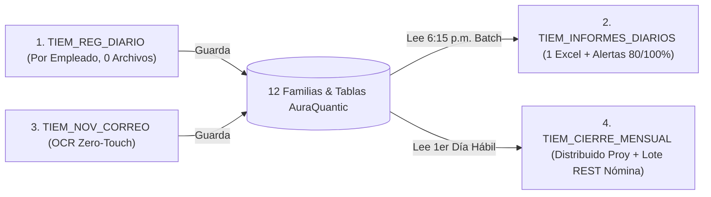

# Fases 1 y 2: Documento de Análisis del Proceso y Propuesta Técnica AuraQuantic (v2.0 Enterprise)

**Caso 1:** Registro de Tiempos, Novedades y Facturación de Horas  
**Programa:** Bootcamp AuraQuantic  
**Versión:** 2.0 Enterprise (Escalable a Cientos de Empleados)  
**Fecha:** 2026-11-27  
**Autor:** Consultoría de Arquitectura y Automatización AuraQuantic  

---

## 1. FASE 1: DOCUMENTO DE ANÁLISIS DEL PROCESO (ENTENDIMIENTO)

### 1.1 Contexto y Objetivos del Negocio
Una firma de servicios profesionales y consultoría con **cientos de empleados** factura a sus clientes por horas y requiere eliminar la dispersión de hojas de cálculo.

**Objetivo de la Solución Enterprise:**  
Implementar en AuraQuantic un ecosistema desacoplado de **4 procesos automatizados** que persiste toda la operación en **Familias Propias (tablas relacionales)** sin generar explosión de archivos por empleado:
* Captura diaria con **15 minutos de gracia automática** (hasta 5:45 p. m.), **alerta 30 minutos antes** (5:00 p. m.) con **revisión de calendario corporativo** (ocupado en reunión/libre) y **temporizador de re-diligenciamiento** en ampliaciones.
* Validación en registro y aprobación de si cada actividad **es para cobro (`EsParaCobro`)**, cálculo de **horas extra reales trabajadas**, **valor real confidencial** y **cruce automático contra permisos/ausentismos**.
* Consolidación diaria ejecutada en **un proceso independiente** (`TIEM_INFORMES_DIARIOS`) que corre 1 sola vez al día para emitir **1 único Excel** para Gerencia y actualizar el presupuesto de proyectos (alertas 80 % y 100 %).
* Automatización de incapacidades por correo con **OCR/IA documental** (ruta *Zero-Touch* ≥90 % de confianza) y bloqueo automático de días hábiles incapacitados.
* Cierre mensual escalable basado en **Familias de Cierre** (`FAM_CIERRE_PROYECTO_MES` y `FAM_CIERRE_NOMINA_MES`): emite **1 solo PDF por proyecto facturable** para firma digital del cliente, transmite a Nómina en **lote REST** y genera certificados PDF de empleados **bajo demanda** desde el Portal.

---

### 1.2 Mapa de Actores y Matriz RACI

| Rol / Actor | Tipo de Usuario en AuraQuantic | Responsabilidades Principales |
| :--- | :--- | :--- |
| **Empleado** | Usuario Interno (Personal) | Registra actividades (`EsParaCobro`, horas reales) y novedades; consulta su saldo de compensación y descarga certificados bajo demanda en su portal. |
| **Líder de Área** | Usuario Interno (Jerárquico) | Autoriza ampliaciones (viendo disponibilidad en calendario) y aprueba horas extra, cobro y horas reales de su equipo. |
| **Director de Proyecto** | Usuario Interno (Asignación Dinámica) | Monitorea presupuesto de sus proyectos; revisa y excluye actividades no facturables con justificación en cierre mensual. |
| **Gerente de Operaciones** | Usuario Interno (Supervisión) | Autoriza ampliaciones excepcionales; recibe el Excel consolidado único diario y supervisa semáforos e indicadores. |
| **Contacto del Cliente** | Usuario Externo (Contacto de Cuenta) | Revisa, observa o firma digitalmente el reporte PDF de su proyecto desde el portal de clientes (aislado por NIT). |
| **Talento Humano (Nómina)** | Usuario Interno (Grupo Funcional) | Valida excepciones OCR de incapacidades; confirma el lote mensual de nómina (acceso confidencial a valores reales) y atiende errores REST. |
| **Administrador del Sistema** | Usuario Administrador | Parametriza proyectos, asignaciones, jornadas, tipos de novedad, gracia (15m), alertas (-30m), OCR (90 %) y calendarios. |
| **Sistema (AuraQuantic Engine)** | Tareas de Sistema y Conectores | Consulta agenda calendario, ejecuta OCR, cruza permisos vs extras, persiste en Familias, consolida Excel único y transmite lote REST. |

| Etapa / Actividad | Empleado | Líder Área | Dir. Proyecto | Ger. Operaciones | Contacto Cliente | Talento Humano | Sistema |
| :--- | :---: | :---: | :---: | :---: | :---: | :---: | :---: |
| **1. Parametrización y sincronización nocturna de proyectos** | I | I | C | I | I | I | **R / A** |
| **2. Apertura diaria (excluye festivos e incapacitados)** | **R** | I | I | I | I | I | **A** |
| **3. Alerta -30 min (5:00 p.m.) + Consulta Calendario** | I | I | I | I | I | I | **R / A** |
| **4. Registro diario (`EsParaCobro`, horas reales) / Gracia 15m** | **R / A** | I | I | I | I | I | I |
| **5. Ampliación de horario + Temporizador re-diligenciamiento** | **R** | **R / A** | I | **A (alt)** | I | I | **R** |
| **6. Aprobación de horas extra, cobro y horas reales** | C | **R / A** | I | I | I | I | I |
| **7. Cruce permisos vs extras + Guardado en `FAM_HORAS_EXTRA`** | I | I | I | I | I | I | **R / A** |
| **8. Consolidado diario único (1 Excel) + Alertas 80 % / 100 %** | I | I | **A** | **I** | I | I | **R / A** |
| **9. Incapacidades por correo con OCR Zero-Touch** | **R** | I | I | I | I | **A (excep.)** | **R** |
| **10. Cierre mensual distribuido, firma digital y lote Nómina** | I | I | **R / A** | I | **R / A** | **A** | **R** |

---

### 1.3 Entradas, Salidas y Arquitectura Sin Explosión de Documentos

* **Principio Arquitectónico para Cientos de Empleados:** Ninguna instancia por empleado (`TIEM_REG_DIARIO`) genera archivos adjuntos ni PDFs individuales. Toda transacción se guarda estructurada en **Familias Propias** y solo se generan documentos en puntos consolidados:
  1. **1 único Excel consolidado al día** (`BIB_INFORMES_DIARIOS`, generado por `TIEM_INFORMES_DIARIOS` a las 6:15 p. m.).
  2. **1 PDF por cada proyecto facturable al mes** (`BIB_REPORTES_PROYECTO`, para firma digital del cliente).
  3. **Certificados PDF de empleado bajo demanda** (generados en tiempo real desde el Portal del Empleado leyendo `FAM_CIERRE_NOMINA_MES`).
  4. **Soportes médicos indexados** (`BIB_SOPORTES_NOVEDADES` clasificados por Año/Mes/Tipo).

---

### 1.4 Reglas de Negocio Formalizadas (`RN-T-01`..`09` + Reglas v2.0)

* **RN-T-01 (Asignación Vigente):** Solo `project key` activo y asignado al empleado en la fecha de actividad.
* **RN-T-02 (Cronología):** `Hora_Fin > Hora_Inicio`.
* **RN-T-03 (Fuera de Jornada):** Solo se aceptan horas fuera de jornada si la actividad está marcada como "Fuera de horario".
* **RN-T-04 (Jerarquía de Ampliación):** Solo Líder de Área o Gerente de Operaciones autorizan ampliación.
* **RN-T-05 (No Traslape):** Sin superposición horaria entre actividades del mismo empleado en el mismo día.
* **RN-T-06 (Tope 16 h):** Total registrado en un día ≤ 16 horas.
* **RN-T-07 (Horas Extra Reales):** Solo cuentan si el Líder las aprueba y el cargo las genera (`GeneraHorasExtra = Sí`).
* **RN-T-08 (Exclusión Factura vs Nómina):** Actividad excluida por Director (`EsParaCobro = No`) no se cobra al cliente, pero permanece íntegra en `FAM_CIERRE_NOMINA_MES`.
* **RN-T-09 (Parametrización Dinámica):** Umbral 80 %, plazos 5/10 días, gracia 15 min, alerta previa 30 min y umbral OCR 90 % parametrizables en `FAM_PARAMETROS`.
* **V2-01 (Gracia 15 min y Alerta -30 min con Calendario):** Recordatorio 30 min antes (5:00 p. m.) consultando disponibilidad Free/Busy en calendario; 15 min de gracia hasta 5:45 p. m. antes de pedir ampliación.
* **V2-02 (Temporizador Re-diligenciamiento):** Tras aprobar ampliación, `ET.03` vigila si el empleado volvió a rellenar antes del nuevo límite.
* **V2-03 (Cruce Permisos vs Horas Extra):** `TS.07` descuenta horas de permiso pendientes (`FAM_NOVEDADES_EMP`) contra las horas extra reales aprobadas antes de guardar en `FAM_HORAS_EXTRA`.

---

### 1.5 Supuestos y Resolución de los 7 Puntos a Definir (Sección 3.10)

1. **No registro ni con ampliación:** `ET.03` cierra el trámite al vencer la prórroga, `TS.03` guarda estado `No Enviado` en `FAM_REGISTROS_DIARIOS` y alerta a Talento Humano.
2. **Destinatario y medio del consolidado Excel:** Se genera 1 único Excel consolidado en `TIEM_INFORMES_DIARIOS` a las 6:15 p. m., enviado por correo al Gerente de Operaciones y archivado en `BIB_INFORMES_DIARIOS`.
3. **Máximo de ampliaciones por día:** 1 única ampliación por día (máximo hasta las 10:00 p. m.), controlada por `ET.03`.
4. **Periodicidad del cálculo:** Cálculo diario en `TS.07` (cruce permisos, horas reales, valor real confidencial y saldo en `FAM_HORAS_EXTRA`/`FAM_SALDO_COMPENSACION`); consolidación de facturación y lote REST nómina en cierre mensual.
5. **Proyecto inactivado a mitad de mes:** Horas previas válidas se facturan en cierre mensual; `RN-T-01` impide nuevos registros desde la fecha de inactivación.
6. **Reasignación en revisión mensual:** Director marca exclusión con justificación (`EsParaCobro = No`) sin alterar nómina (`RN-T-08`), o rechaza para corrección del empleado.
7. **Novedad multidía (incapacidad):** `TS.24` guarda el rango en `FAM_NOVEDADES_EMP` y pre-marca todos los días hábiles en `FAM_REGISTROS_DIARIOS` para que `EI.01` no cree tareas diarias ni alertas al incapacitado.

---

## 2. FASE 2: ARQUITECTURA TO-BE, MAPA DE FAMILIAS Y BPMN

### 2.1 Mapa Maestro de Familias y Bibliotecas (Dónde Sale y Dónde se Guarda)

| Familia / Biblioteca | Quién Guarda (Escritura) | Quién Lee (Lectura) | Propósito de Escalabilidad |
| :--- | :--- | :--- | :--- |
| **`FAM_REGISTROS_DIARIOS`** | `TS.07`, `TS.03`, `TS.24` | `TS.11` (Informe único) | Cabecera diaria por empleado (0 archivos adjuntos por persona). |
| **`FAM_DETALLE_ACTIVIDADES`** | `TS.07` | `TS.11`, `TS.13`, `TS.30` | Línea a línea con `EsParaCobro` y horas reales. |
| **`FAM_HORAS_EXTRA`** | `TS.07` | `TS.11`, `TS.30`, Portal TH | Guarda horas extra reales, cruce permisos y `ValorRealCOP` (solo TH). |
| **`FAM_NOVEDADES_EMP`** | `TS.24`, `TS.07` (cruce) | `EI.01`, `TS.07`, `TS.11`, `TS.30` | Incapacidades/permisos multidía y saldo de permisos por cruzar. |
| **`FAM_SALDO_COMPENSACION`** | `TS.07` | Portal Empleado | Saldo acumulado neto visible en vivo al empleado. |
| **`FAM_PROYECTOS`** | Admin, REST Nocturno, `TS.13/14/15` | `TP.01`, `DO.11`, Tablero | Presupuesto, consumo acumulado y banderas únicas 80 % / 100 %. |
| **`FAM_ASIGNACIONES`** | Administrador | `TP.01` (limitado) | Vigencia `FechaDesde..FechaHasta` (`RF-T-03`). |
| **`FAM_JORNADAS` / `FAM_TIPOS_NOVEDAD` / `FAM_PARAMETROS`** | Administrador (`RT-15`) | `TS.01`, `TP.01`, `DO.11`, `ET.01/31/32` | Horarios, soporte obligatorio, gracia 15m, alerta -30m, OCR 90 %, plazos 5/10d. |
| **`FAM_CIERRE_PROYECTO_MES`** | `TS.30`, `TP.31`, `TS.33` | `TS.31`, `CA.31+`, `TS.34` | 1 fila por proyecto facturable; controla firma/tácita. |
| **`FAM_CIERRE_NOMINA_MES`** | `TS.30`, `TS.35` | `TS.35` (REST Lote), `TP.33`, Portal Emp. | 1 fila por empleado; lote JSON a Nómina y PDF **bajo demanda**. |
| **`BIB_INFORMES_DIARIOS`** | `TS.12` | Gerencia Operaciones | **1 único Excel por día hábil** (no N archivos). |
| **`BIB_SOPORTES_NOVEDADES`** & **`BIB_REPORTES_PROYECTO`** | `TS.23`, `TS.31`, `TS.33` | TH, Cliente (NIT), Auditoría | Soportes médicos (Año/Mes/Tipo) + 1 PDF por proyecto facturable. |

---

### 2.2 Los 4 Procesos BPMN Desacoplados

1. **`TIEM_REG_DIARIO` (Por Empleado):** Apertura hábil (excluye incapacitados) → `TP.01` (`EsParaCobro`, horas reales, precarga, borrador) + Alerta `-30m` (`5:00 p. m.`) con **Conector Calendario** + **Gracia 15m (`5:45 p. m.`)** → Ampliación con **Temporizador `ET.03`** → Aprobación Extras → **`TS.07` (Valor real + Cruce permisos → Guarda en `FAM_REGISTROS_DIARIOS`, `FAM_DETALLE_ACTIVIDADES`, `FAM_HORAS_EXTRA`, `FAM_SALDO_COMPENSACION`)** → Fin (0 archivos).
2. **`TIEM_INFORMES_DIARIOS` (1 Instancia/Día a las 6:15 p. m.):** Lee tablas del día → Paralela `DA.11+`: Rama A genera **1 único Excel consolidado** en `BIB_INFORMES_DIARIOS` para Operaciones; Rama B actualiza `FAM_PROYECTOS` y dispara alertas `DO.11` (80 % / 100 %).
3. **`TIEM_NOV_CORREO` (Correo Entrante IMAP):** Valida remitente → Valida adjunto → **Conector OCR/IA (`TS.23`)** extrae fechas/CIE-10 y guarda PDF en `BIB_SOPORTES_NOVEDADES` → `DX.23`: si `OCR ≥ 90 %` pasa directo (**Zero-Touch**); si `<90 %` pasa a `TP.20` (TH) → `TS.24` guarda en `FAM_NOVEDADES_EMP` y marca días hábiles en `FAM_REGISTROS_DIARIOS`.
4. **`TIEM_CIERRE_MENSUAL` (1er Día Hábil):** `TS.30` consolida en `FAM_CIERRE_PROYECTO_MES` y `FAM_CIERRE_NOMINA_MES` → `SP.31` (Tratamiento Distribuido 1..N proyectos: Director `TP.31`, 1 PDF/proyecto `TS.31`, Firma Digital `TP.32` + timers 5/10d) → Confluencia `CA.31+` → Paralela `DA.31+`: Rama A 1 resumen a Finanzas; Rama B **POST REST Lote Nómina** (`TS.35` + Reto 3 reintentos `DX.33`) + `TP.33` confirmación lote TH (Certificados PDF bajo demanda en Portal Empleado).

---

### 2.3 Estimación Calibrada por Objeto (80.0 Horas Guía Exactas)

| Categoría | Objetos AuraQuantic | Horas |
| :--- | :--- | :---: |
| **1. Estructura Org. y Familias** | Árbol Org/Empleados (3h), Proyectos/Asignaciones (4h), Jornadas/Novedades/Parámetros/Cierre/Extra (5h) | **12.0 h** |
| **2. Términos y Formularios UI** | Diccionario/Contadores (2.5h), Grupos Campos (4h), `FORM_REGISTRO_DIARIO` (4h), Líder/Director/Cliente/TH (7.5h) | **18.0 h** |
| **3. 4 Clases de Proceso BPMN** | `TIEM_REG_DIARIO` (8h), `TIEM_INFORMES_DIARIOS` (3h), `TIEM_NOV_CORREO` (3.5h), `TIEM_CIERRE_MENSUAL` (6.5h) | **21.0 h** |
| **4. Tareas Sistema y Docs Base** | Notificadores/Cruce/Limpiador/Desviador (7h), Excel Único + PDF Proyecto + Certificado Bajo Demanda (6h) | **13.0 h** |
| **5. Conectores e Integraciones** | REST Festivos CO (1.5h), REST Proyectos (1.5h), REST Calendario (1.5h), REST Nómina Lote (2h), IMAP + OCR (2.5h) | **9.0 h** |
| **6. Portales e Indicadores** | Portales Empleado/Líder/Cliente NIT (4.5h), Cuadro de Mandos + Universal Watcher (2.5h) | **7.0 h** |
| **TOTAL ALCANCE MÍNIMO** | **Desviación: 0.0 % vs 80 h guía (Cumple ±25 %)** | **80.0 h** |

---

## 3. CHECKLIST RESUMIDO DE COMPROBACIÓN POR REQUERIMIENTO

La trazabilidad y comprobación completa de los **68 ítems** (`RF-T-01`..`32`, `RN-T-01`..`09`, `RT-01`..`17` y `V2-01`..`10`) se encuentra detallada y verificable fila por fila en:
* Hoja **`Matriz_Cobertura_RF_RT`** y Hoja **`Matriz_Pruebas_QA`** de `Caso1_Estimacion_Horas_AuraQuantic.xlsx`.
* Pestaña **`6. ✅ Comprobación Requisitos (68)`** de `Caso1_Prototipo_Navegable_AuraQuantic.html`.
* Criterio transversal clave de comprobación: verificar en ejecución que **ningún trámite diario de empleado genere archivos adjuntos** (`0` archivos en `TIEM_REG_DIARIO`), que exista **1 único Excel diario** en `BIB_INFORMES_DIARIOS`, que las **horas extra se crucen contra permisos** antes de guardar en `FAM_HORAS_EXTRA`, y que en cierre mensual solo se emita **1 PDF por proyecto facturable** mientras Nómina recibe **lote JSON REST**.
