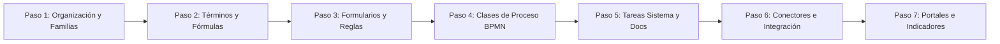

# Fases 3 y 4: Prototipos de Pantallas y Guía de Construcción en AuraQuantic

**Caso 1:** Registro de Tiempos, Novedades y Facturación de Horas  
**Programa:** Bootcamp AuraQuantic  
**Versión:** 2.0  
**Fecha:** 2026-11-18  

---

## 1. FASE 3: PROTOTIPOS Y ESPECIFICACIÓN DE PANTALLAS (UI & UX)

### 1.1 Lineamientos Generales de Diseño (RT-01, RT-07, RT-10)
* **Paleta Corporativa:** Fondo neutro (`#F4F6F8`), Encabezados y Primarios en Navy (`#00015A`), Acentos y botones de acción en Mint (`#3FF2CF`), Advertencias en Ámbar (`#FFB020`), Alertas en Rojo (`#D32F2F`).
* **Tipografía:** *Segoe UI* / *Roboto*, tamaños jerarquizados (Títulos: 18-20px, Etiquetas: 13px bold, Valores: 14px).
* **Bloque de Ayuda (RT-07):** Presente en la parte superior de cada formulario en un panel sombreado de 3 líneas explicando el objetivo y el impacto de la acción.
* **Responsive / Uso Móvil (RT-10):** Los formularios se diseñan en cuadrícula flexible (12 columnas) para colapsar ordenadamente en la aplicación móvil de AuraQuantic.

---

### 1.2 Formulario 1: Registro Diario del Empleado (`FORM_REGISTRO_DIARIO`)

```
┌────────────────────────────────────────────────────────────────────────────────────────┐
│  [LOGO EMPRESA]   REGISTRO DIARIO DE TIEMPOS Y NOVEDADES         Trámite: TIEM-2026-000128  │
├────────────────────────────────────────────────────────────────────────────────────────┤
│  ℹ️ Ayuda: Registre todas las actividades y novedades de su jornada laboral. Guarde su     │
│  avance en cualquier momento con "Guardar Borrador". Recuerde enviar antes de las 5:30 p.m.  │
├────────────────────────────────────────────────────────────────────────────────────────┤
│  Empleado: Juan Pérez               | Cargo: Consultor Senior   | Fecha: 18/11/2026 (Mié)  │
│  Líder Directo: Carlos Mendoza      | Jornada: 07:00 a 17:30    | Horas Esperadas: 10.5 h   │
├────────────────────────────────────────────────────────────────────────────────────────┤
│  [📋 Precargar Día Hábil Anterior]                                    [💾 Guardar Borrador] │
├────────────────────────────────────────────────────────────────────────────────────────┤
│  ▼ ACTIVIDADES LABORADAS                                                               │
│  ┌────────────┬───────┬───────┬──────────────┬──────────────────┬────────┬──────────┐  │
│  │ Fecha      │ Inicio│ Fin   │ Proyecto     │ Descripción      │ ¿Extra?│ Duración │  │
│  ├────────────┼───────┼───────┼──────────────┼──────────────────┼────────┼──────────┤  │
│  │ 18/11/2026 │ 07:00 │ 12:00 │ [PRY-BANCO1] │ Análisis req.    │ [ ] No │  5.0 h   │  │
│  │ 18/11/2026 │ 13:00 │ 17:30 │ [PRY-TELCO2] │ Modelo BPMN      │ [ ] No │  4.5 h   │  │
│  │ 18/11/2026 │ 17:30 │ 19:30 │ [PRY-BANCO1] │ Ajuste conector  │ [X] Sí │  2.0 h   │  │
│  └────────────┴───────┴───────┴──────────────┴──────────────────┴────────┴──────────┘  │
│  [+ Agregar Actividad]                                       Subtotal Actividades: 11.5 h│
├────────────────────────────────────────────────────────────────────────────────────────┤
│  ▼ NOVEDADES Y AUSENTISMOS                                                             │
│  ┌───────────────────────┬──────────┬──────────────────────┬─────────────────────────┐ │
│  │ Tipo de Novedad       │ Duración │ Observaciones        │ Soporte Adjunto (PDF)   │ │
│  ├───────────────────────┼──────────┼──────────────────────┼─────────────────────────┤ │
│  │ Permiso Médico        │  1.0 h   │ Cita odontológica    │ [📎 cita_soporte.pdf]   │ │
│  └───────────────────────┴──────────┴──────────────────────┴─────────────────────────┘ │
│  [+ Agregar Novedad]                                           Subtotal Novedades:  1.0 h│
├────────────────────────────────────────────────────────────────────────────────────────┤
│  ▼ BALANCE DE LA JORNADA                                                               │
│  Horas Laboradas: 11.5 h | Novedades: 1.0 h | Total Registrado: 12.5 h                 │
│  Jornada Base:    10.5 h | Horas Ordinarias: 10.5 h | Horas Extra Solicitadas: 2.0 h   │
│  Diferencia Jornada: +2.0 h (A favor de compensación o extras según aprobación)       │
├────────────────────────────────────────────────────────────────────────────────────────┤
│  [ ❌ Cancelar ]                                               [ 🚀 ENVIAR REGISTRO ]  │
└────────────────────────────────────────────────────────────────────────────────────────┘
```

#### Especificación Técnica de Campos y Reglas en Formulario 1:

| Campo / Control | Tipo de Término | Propiedades y Reglas de Negocio |
| :--- | :--- | :--- |
| **`Empleado` / `Cargo`** | Término Sistema | Solo lectura. Precargado con el usuario en sesión. |
| **`Jornada` / `Horas Esperadas`** | Término Dinámico | Solo lectura. Lee de `FAM_JORNADAS` según día de la semana. |
| **Botón `Precargar Día Anterior`** | Acción / Botón | Dispara Tarea de Sistema Traspasador que clona las filas de actividades del día hábil anterior (RF-T-10). |
| **Botón `Guardar Borrador`** | Botón de Acción | Guarda los datos sin avanzar el token BPMN ni ejecutar validaciones de cierre (RF-T-09). |
| **Columna `Proyecto`** | Término Limitado | **Filtro Familia-Relación:** `FAM_ASIGNACIONES.Empleado == Empleado_Sesion && FAM_ASIGNACIONES.Fecha_Hasta >= Hoy && FAM_PROYECTOS.Estado == 'Activo'`. |
| **Columna `¿Extra?`** | Booleano | Si `Empleado.Genera_Horas_Extra == 'NO'`, el control se desactiva y queda en "No" fijo (RF-T-20). |
| **Columna `Duración`** | Numérico Calculado | **Fórmula:** `(Hora_Fin - Hora_Inicio) en horas decimales`. Validación: `Hora_Fin > Hora_Inicio`. |
| **Columna `Soporte Adjunto`** | Documento | **Condición de Disparo:** Si `FAM_TIPOS_NOVEDAD.Exige_Soporte == 'SÍ'`, el campo se marca **Obligatorio** para permitir el envío (RF-T-13). |
| **Balance de Jornada** | Panel Calculado | Sumatorias dinámicas que se actualizan en pantalla en tiempo real (RF-T-08). |

---

### 1.3 Formulario 2: Solicitud / Autorización de Ampliación de Horario (`FORM_AMPLIACION_HORARIO`)

```
┌────────────────────────────────────────────────────────────────────────────────────────┐
│  [LOGO EMPRESA]        AUTORIZACIÓN DE AMPLIACIÓN DE HORARIO     Trámite: TIEM-2026-000128  │
├────────────────────────────────────────────────────────────────────────────────────────┤
│  ℹ️ Ayuda: El empleado no completó su registro a las 5:30 p.m. Ingrese el motivo y la      │
│  nueva hora límite para habilitar el formulario.                                       │
├────────────────────────────────────────────────────────────────────────────────────────┤
│  Empleado: Juan Pérez               | Área: Consultoría Cloud   | Fecha: 18/11/2026    │
│  Líder Responsable: Carlos Mendoza  | Hora de Cierre Regular: 17:30                    │
├────────────────────────────────────────────────────────────────────────────────────────┤
│  * Motivo de la Solicitud / Autorización:                                              │
│  [ El consultor se encontraba en sesión técnica continua con el cliente hasta las 18:00]│
│                                                                                        │
│  * Nueva Hora Límite de Envío: [ 20:00 ] (Máximo permitido: 22:00)                    │
├────────────────────────────────────────────────────────────────────────────────────────┤
│  [ ❌ RECHAZAR / CERRAR DÍA ]                         [ ✔️ AUTORIZAR AMPLIACIÓN ]       │
└────────────────────────────────────────────────────────────────────────────────────────┘
```

#### Reglas de Negocio en Formulario 2:
* **Participante:** Asignado dinámicamente al Líder de Área del Empleado o al Gerente de Operaciones (RN-T-04).
* **Validación de Hora:** `Nueva_Hora_Limite > Hora_Actual` y `Nueva_Hora_Limite <= 22:00`.
* **Impacto:** Si se autoriza, el trámite queda catalogado con el indicador "Registro con Ampliación" para los tableros de cumplimiento (RF-T-17).

---

### 1.4 Formulario 3: Aprobación de Horas Extra por el Líder (`FORM_APROBACION_EXTRAS`)

```
┌────────────────────────────────────────────────────────────────────────────────────────┐
│  [LOGO EMPRESA]         APROBACIÓN DE ACTIVIDADES FUERA DE HORARIO                      │
├────────────────────────────────────────────────────────────────────────────────────────┤
│  ℹ️ Ayuda: Revise cada actividad marcada fuera de horario. Las aprobadas computarán     │
│  para horas extra; las rechazadas regresarán al empleado con sus observaciones.        │
├────────────────────────────────────────────────────────────────────────────────────────┤
│  Empleado: Juan Pérez | Área: Consultoría Cloud | Horas Extra Solicitadas: 2.0 h       │
├────────────────────────────────────────────────────────────────────────────────────────┤
│  ▼ REVISIÓN LÍNEA POR LÍNEA:                                                           │
│  ┌────────────┬───────┬───────┬──────────────┬──────────────────┬──────────┬─────────┐ │
│  │ Fecha      │ Inicio│ Fin   │ Proyecto     │ Descripción      │ Decisión │ Coment. │ │
│  ├────────────┼───────┼───────┼──────────────┼──────────────────┼──────────┼─────────┤ │
│  │ 18/11/2026 │ 17:30 │ 19:30 │ [PRY-BANCO1] │ Ajuste conector  │ [Aprobar]│ OK prod.│ │
│  └────────────┴───────┴───────┴──────────────┴──────────────────┴──────────┴─────────┘ │
├────────────────────────────────────────────────────────────────────────────────────────┤
│  [ 💾 GUARDAR DECISIÓN Y FINALIZAR ]                                                   │
└────────────────────────────────────────────────────────────────────────────────────────┘
```

---

### 1.5 Formulario 4: Revisión Mensual del Director de Proyecto (`FORM_CIERRE_PROYECTO`)

```
┌────────────────────────────────────────────────────────────────────────────────────────┐
│  [LOGO EMPRESA]          CIERRE MENSUAL DE HORAS POR PROYECTO   Periodo: 2026-10        │
├────────────────────────────────────────────────────────────────────────────────────────┤
│  Proyecto: PRY-BANCO1 - Modernización Core  | Cliente: Banco Nacional S.A.             │
│  Director: Andrés Silva                     | Presupuesto Total: 500 h | Consumo: 380 h│
├────────────────────────────────────────────────────────────────────────────────────────┤
│  ▼ DETALLE DE HORAS DEL MES REGISTRADAS POR EL EQUIPO:                                 │
│  ┌────────────┬───────────────┬───────┬──────────────────┬────────────┬──────────────┐ │
│  │ Fecha      │ Empleado      │ Horas │ Actividad        │ ¿Facturar? │ Justificación│ │
│  ├────────────┼───────────────┼───────┼──────────────────┼────────────┼──────────────┤ │
│  │ 05/10/2026 │ Juan Pérez    │  8.0  │ Requisitos API   │ [X] Sí     │              │ │
│  │ 12/10/2026 │ Ana Gómez     │  4.0  │ Capacitación int.│ [ ] No     │ No cobrable  │ │
│  │ 20/10/2026 │ Juan Pérez    │  6.0  │ Pruebas carga    │ [X] Sí     │              │ │
│  └────────────┴───────────────┴───────┴──────────────────┴────────────┴──────────────┘ │
│  Total Horas Registradas: 18.0 h | Horas Excluidas: 4.0 h | TOTAL A FACTURAR: 14.0 h   │
├────────────────────────────────────────────────────────────────────────────────────────┤
│  [ 📄 GENERAR REPORTE PDF Y ENVIAR AL CLIENTE ]                                        │
└────────────────────────────────────────────────────────────────────────────────────────┘
```

---

### 1.6 Formulario 5: Portal y Firma Digital del Cliente (`FORM_CLIENTE_FIRMA`)

```
┌────────────────────────────────────────────────────────────────────────────────────────┐
│  PORTAL DE CLIENTES - BANCO NACIONAL S.A.               Contacto: Ing. Roberto Méndez  │
├────────────────────────────────────────────────────────────────────────────────────────┤
│  Aprobación de Reporte Mensual de Horas - Proyecto: PRY-BANCO1                         │
│  Periodo: Octubre 2026 | Total Horas a Facturar: 14.0 horas                            │
├────────────────────────────────────────────────────────────────────────────────────────┤
│  ┌──────────────────────────────────────────────────────────────────────────────────┐  │
│  │  [ VISOR DE DOCUMENTO PDF INTEGRADO CON DOCUMENTO BASE ]                         │  │
│  │  • Empresa de Consultoría S.A.S.                                                 │  │
│  │  • Cliente: Banco Nacional S.A. - NIT: 890.123.456-1                             │  │
│  │  • Desglose por profesional y actividad...                                       │  │
│  │  • Total Certificado: 14.0 Horas.                                                │  │
│  └──────────────────────────────────────────────────────────────────────────────────┘  │
├────────────────────────────────────────────────────────────────────────────────────────┤
│  Observaciones (opcional si aprueba; obligatorio si rechaza):                          │
│  [                                                                                    ]│
├────────────────────────────────────────────────────────────────────────────────────────┤
│  Certificado Digital: [ Certificado_Pruebas_AuraQuantic_2026 ]                         │
│  [ ⚠️ REGISTRAR OBSERVACIONES ]                         [ ✍️ FIRMAR DIGITALMENTE ]     │
└────────────────────────────────────────────────────────────────────────────────────────┘
```

---

## 2. FASE 4: GUÍA MAESTRA DE CONSTRUCCIÓN PASO A PASO EN AURAQUANTIC

A continuación tienes el procedimiento exacto para implementar cada elemento en el ambiente de pruebas.



---

### Paso 1: Configurar Organización, Cuentas y Familias Propias

1. **Árbol Organizacional (Curso 2.02):**
   * Ve a *Estructura Organizacional > Departamentos y Cargos*.
   * Crea la división *Operaciones* y dentro los departamentos: *Consultoría*, *Talento Humano*, *Dirección*.
   * Crea los Cargos: `Consultor Junior`, `Consultor Senior`, `Líder de Área`, `Director de Proyecto`, `Gerente de Operaciones`.
   * En *Usuarios/Empleados*, da de alta mínimo 5 empleados de prueba. En su ficha personal, agrega en los atributos personalizados:
     * `Genera_Horas_Extra`: Booleano (SÍ para Consultores, NO para Directores/Líderes).
     * `Lider_Directo`: Selector de Empleado (asigna a Carlos Mendoza como líder de Juan Pérez).
     * `Valor_Hora`: Numérico (Confidencial, perfil restringido a Talento Humano).
     * `Saldo_Compensacion`: Numérico Decimal (Inicia en 0.0).

2. **Cuentas y Contactos (Clientes Externos):**
   * En *Gestión de Cuentas*, crea al cliente: *Banco Nacional S.A.* (NIT `890123456`).
   * Crea el contacto: *Roberto Méndez* con su correo. En su ficha de usuario, asígnale el perfil de **Usuario Externo (Portal Clientes)**.

3. **Creación de Familias Propias:**
   * En *Estructura de Datos > Familias Propias*, crea las siguientes 4 familias con su prefijo:
     * `FAM_PROYECTOS`: Código (Texto único), Nombre (Texto), Cliente (Relación Cuenta), Director (Relación Empleado), Presupuesto_Horas (Numérico), Horas_Consumidas (Numérico default 0), Estado (Lista: Activo/Inactivo/Cerrado).
     * `FAM_ASIGNACIONES`: Empleado (Relación Empleado), Proyecto (Relación `FAM_PROYECTOS`), Fecha_Desde (Fecha), Fecha_Hasta (Fecha), Activo (Booleano calculado).
     * `FAM_TIPOS_NOVEDAD`: Nombre (Texto), Es_Remunerada (Booleano), Exige_Soporte (Booleano). Carga 5 registros: *Incapacidad (Sí, Sí)*, *Permiso Médico (Sí, Sí)*, *Calamidad (Sí, No)*, *Llegada Tarde (No, No)*, *Ausencia Injustificada (No, No)*.
     * `FAM_JORNADAS`: Dia_Semana (Lista), Hora_Apertura (Hora), Hora_Cierre (Hora). Configura Lun-Mar de 08:00 a 17:30 y Mie-Vie de 07:00 a 17:30.

---

### Paso 2: Crear el Diccionario de Términos y Grupos de Campos

1. **Términos de Cabecera:**
   * `Numero_Tramite`: Tipo Contador, máscara `TIEM-@YYYY@-@######@`.
   * `Fecha_Registro`: Tipo Fecha.
   * `Empleado_Responsable`: Tipo Empleado.
   * `Lider_Area`: Tipo Empleado.
   * `Estado_Tramite`: Tipo Lista.
   * `Motivo_Ampliacion`: Tipo Texto Multilínea.
   * `Nueva_Hora_Limite`: Tipo Hora.

2. **Grupo de Campos (Tabla de Actividades):**
   * Nombre: `GC_ACTIVIDADES`.
   * Agrega las columnas:
     * `Col_Fecha` (Fecha).
     * `Col_Hora_Inicio` (Hora).
     * `Col_Hora_Fin` (Hora).
     * `Col_Proyecto`: Selector Tipo Familia-Relación hacia `FAM_ASIGNACIONES`. Configura el filtro SQL/AuraQuantic:
       ```sql
       WHERE FAM_ASIGNACIONES.Empleado = @Empleado_Sesion@ 
         AND FAM_ASIGNACIONES.Fecha_Hasta >= @Fecha_Hoy@
         AND FAM_PROYECTOS.Estado = 'Activo'
       ```
     * `Col_Descripcion` (Texto Multilínea).
     * `Col_Fuera_Horario` (Booleano).
     * `Col_Duracion` (Numérico Decimal 2 decimales). Define la fórmula en el evento `Al cambiar Hora_Fin`:
       `Col_Duracion = DATEDIFF(minute, Col_Hora_Inicio, Col_Hora_Fin) / 60.0`.
     * `Col_Estado_Aprobacion` (Lista: *Pendiente, Aprobada, Rechazada*).
     * `Col_Facturable_Cliente` (Booleano, Default = SÍ).

3. **Grupo de Campos (Tabla de Novedades):**
   * Nombre: `GC_NOVEDADES`.
   * Columnas: `Col_Tipo_Novedad` (Relación a `FAM_TIPOS_NOVEDAD`), `Col_Duracion_Horas` (Numérico), `Col_Observaciones` (Texto), `Col_Soporte_Adjunto` (Documento).

---

### Paso 3: Construir los Formularios y Reglas Visuales

1. **Construcción del Formulario Diario (`FORM_REGISTRO_DIARIO`):**
   * Abre el diseñador de formularios de AuraQuantic.
   * Inserta un panel de encabezado con los datos del trámite y el texto de ayuda (RT-07).
   * Inserta los controles de `GC_ACTIVIDADES` y `GC_NOVEDADES` en pestañas o paneles colapsables.
   * **Regla de Disparo en Novedades:**
     * Ve a *Lógica de Formulario > Condiciones y Disparos*.
     * Crea la regla: *SI `GC_NOVEDADES.Col_Tipo_Novedad.Exige_Soporte == Verdadero` ENTONCES hacer `GC_NOVEDADES.Col_Soporte_Adjunto` Obligatorio y Visible*.
   * **Botón Borrador:** Agrega un botón "Guardar Borrador" configurado con la acción estándar *Guardar sin validar ni avanzar*.
   * **Botón Precargar:** Configura el botón para ejecutar el traspaso de registros del día hábil anterior.

2. **Formulario de Ampliación de Horario (`FORM_AMPLIACION_HORARIO`):**
   * Asigna los campos `Motivo_Ampliacion` y `Nueva_Hora_Limite` como obligatorios.
   * Botones de pie: *Autorizar Ampliación* (avanza compuerta hacia SÍ) y *Rechazar* (avanza hacia NO).

---

### Paso 4: Modelar la Clase de Proceso `TIEM_REG_DIARIO`

1. **Creación de la Clase de Proceso:**
   * Crea la clase de proceso BPMN con nombre `TIEM_REG_DIARIO`.
2. **Evento de Inicio Temporizado:**
   * Configura el disparador temporal para ejecutarse en días hábiles (según calendario sin festivos) a las 08:00 a. m. (Lun-Mar) y 07:00 a. m. (Mie-Vie).
   * AuraQuantic creará una instancia para cada empleado activo mediante ejecución por lotes continua (Curso 3.07).
3. **Tarea Personal del Empleado:**
   * Nombre: *Registrar Tiempos del Día*.
   * Asignación: *Iniciador del Proceso*.
   * Formulario: `FORM_REGISTRO_DIARIO`.
4. **Manejo de Alerta y Plazo de Cierre:**
   * Inserta un **Evento Intermedio Temporizado de Frontera (No Interruptor)** fijado a las 16:30. Conecta una Tarea de Sistema *Notificador* que envíe email y notificación móvil recordatoria.
   * Inserta un **Evento Temporizado de Frontera (Interruptor)** fijado a las 17:30. Conecta la salida a la Tarea Personal del Líder *Autorizar Ampliación*.
5. **Compuerta de Horas Extra:**
   * Evalúa la condición: `GC_ACTIVIDADES.Col_Fuera_Horario CONTIENE 'SÍ' Y Empleado.Genera_Horas_Extra == 'SÍ'`.
   * Si es Verdadero -> Dirige a la Tarea Personal *Aprobar Horas Extra* asignada al rol dinámico `Lider_Area`.
   * Si es Falso -> Dirige a la Tarea de Sistema *Consolidar y Calcular Saldos*.

---

### Paso 5: Modelar la Clase de Proceso `TIEM_CIERRE_MENSUAL`

1. **Evento de Inicio:**
   * Temporizado el primer día hábil del mes a las 06:00 a. m.
2. **Tratamiento Distribuido (Subproceso Causal):**
   * Configura el componente de *Tratamiento Distribuido*: AuraQuantic consulta la familia `FAM_PROYECTOS` con filtro `Es_Facturable == 'SÍ' Y Estado == 'Activo'` y abre un subproceso independiente por cada proyecto.
3. **Subproceso de Proyecto:**
   * **Tarea 1 (Director de Proyecto):** *Validar Horas Proyecto*. Formulario `FORM_CIERRE_PROYECTO`.
   * **Tarea 2 (Sistema - Documento Base):** Genera el archivo PDF combinando la plantilla Word con los datos de las horas aprobadas.
   * **Tarea 3 (Externa - Contacto Cliente):** Publica el reporte en el expediente del cliente y genera la tarea de portal para el contacto del cliente con botón de firma digital.
   * **Temporizadores de Cliente:**
     * A los 5 días hábiles sin respuesta: Tarea de Sistema Notificador envía recordatorio al cliente.
     * A los 10 días hábiles sin respuesta: Compuerta deriva a la tarea de sistema que estampa la marca de *Aprobación Tácita* y finaliza el subproceso del proyecto.
4. **Confluencia:**
   * La compuerta confluencial espera a que el 100 % de los subprocesos de proyectos del mes finalicen.
   * Al confluir, ejecuta una Tarea de Sistema *Notificador* que adjunta el resumen consolidado a Finanzas y ejecuta el Conector REST hacia Nómina.

---

### Paso 6: Configurar Conectores REST y Correo Entrante (Anexo B)

1. **Conector REST Festivos de Colombia:**
   * Ve a *Integración > Conectores REST*.
   * Crea el conector `REST_FESTIVOS_COLOMBIA`:
     * Método: `GET`.
     * URL: `https://date.nager.at/api/v3/PublicHolidays/2026/CO`.
     * Mapeo de Respuesta: Itera sobre el array JSON mapeando `date` al Calendario Laboral de AuraQuantic con tipo "Festivo no laborable".
2. **Conector REST Gestión de Proyectos:**
   * Conector `REST_SYNC_PROYECTOS`:
     * Método: `GET`.
     * URL: `{URL_MOCK_INSTRUCTOR}/proyectos?fecha_desde=@Fecha_Ayer@`.
     * Mapeo: Actualiza o inserta en `FAM_PROYECTOS`.
3. **Conector REST Nómina:**
   * Conector `REST_ENVIO_NOMINA`:
     * Método: `POST`.
     * URL: `{URL_MOCK_INSTRUCTOR}/nomina/novedades`.
     * Body JSON:
       ```json
       {
         "periodo": "@Periodo_Mes@",
         "id_empleado": "@Empleado.Identificacion@",
         "horas_extra": @Total_Extras_Mes@,
         "ausentismos": @Total_Ausentismo_Mes@
       }
       ```
     * Política de reintentos: 3 intentos con intervalo de 5 minutos. Si falla, genera tarea para Talento Humano con el código de error devuelto (RF-T-31).
4. **Conector de Correo Entrante (RF-T-15):**
   * Ve a *Integración > Buzones de Correo Entrante*.
   * Configura la cuenta IMAP del buzón de novedades.
   * Regla de activación: Al recibir nuevo correo, inicia el proceso `TIEM_NOV_CORREO`.
   * Si el remitente `@Remitente@` existe en `FAM_EMPLEADOS`, extrae los adjuntos y los guarda en la carpeta del empleado; si no existe, responde con plantilla de correo: *"El correo no corresponde a un empleado activo. No fue procesado"*.

---

### Paso 7: Configuración de Portales y Cuadros de Mando (Curso 4)

1. **Portal del Empleado (Curso 4.03):**
   * Crea una página de portal titulada *Mi Espacio de Trabajo*.
   * Agrega los siguientes widgets:
     * *Bandeja de Tareas Personales:* Filtro por defecto para mostrar la tarea de registro del día.
     * *Indicador de Saldo Compensatorio:* Muestra el término numérico acumulado de horas a favor o en contra.
     * *Gráfico de Barras:* Horas registradas en los últimos 7 días desglosadas por proyecto.
2. **Portal de Clientes Externos:**
   * Configura la página de inicio para el rol *Contacto de Cliente*.
   * Agrega un visor de documentos filtrado por: `Cuenta_Cliente == Cliente_Sesión`. El cliente únicamente ve los reportes pertenecientes a su razón social (RT-14).
3. **Cuadro de Mandos / Universal Watcher (Curso 4.02):**
   * Crea un informe dinámico sobre la familia `FAM_PROYECTOS` con las columnas: *Proyecto, Director, Presupuesto, Consumido, % Consumo, Semáforo*.
   * **Lógica del Semáforo:**
     * Verde: `% Consumo < 80 %`.
     * Amarillo: `% Consumo >= 80 % Y % Consumo <= 100 %`.
     * Rojo: `% Consumo > 100 %` (Sobreconsumo).
   * Configura una regla de monitoreo en AuraQuantic (*Universal Watcher*) para disparar un email de alerta inmediata al Director en el momento exacto en que un proyecto toque el 80 %.
